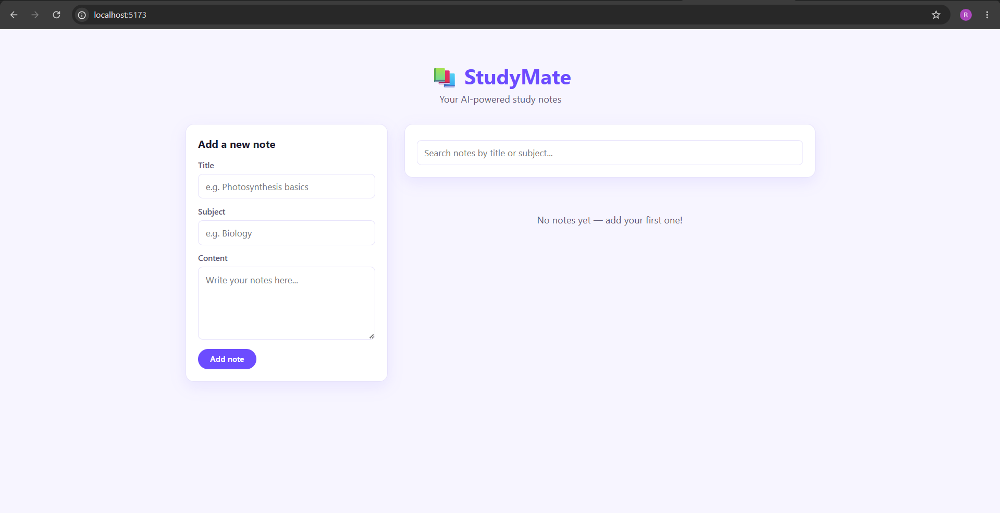
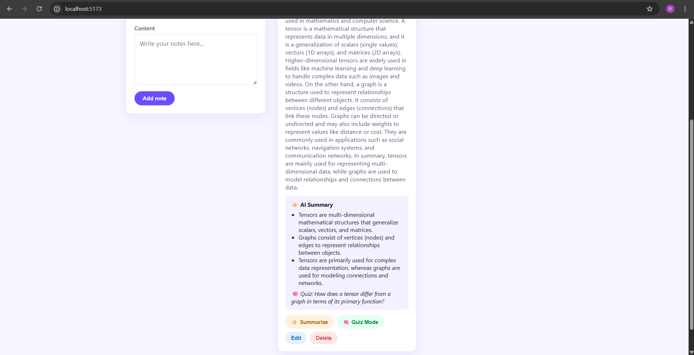
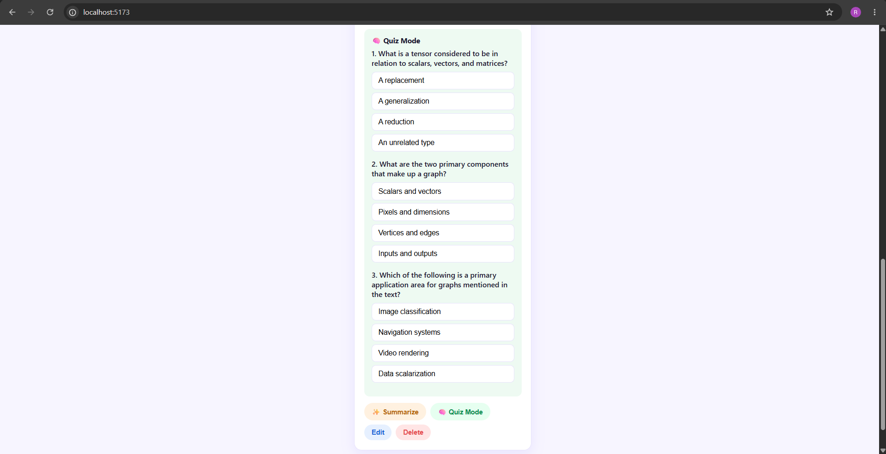
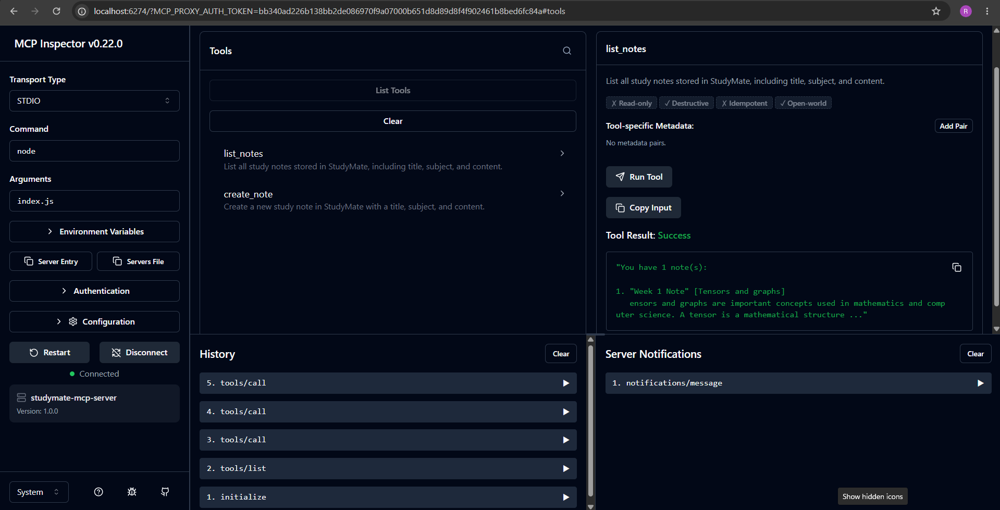
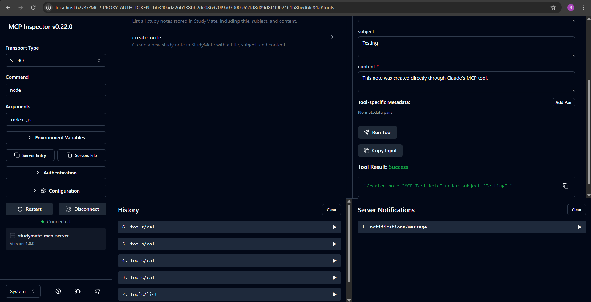

# 📚 StudyMate - Your AI-Powered Study Notes App

StudyMate is a full-stack study notes app: create a private account, capture notes by subject, get an AI generated 3-bullet summary + quiz question for any note, take an AI-generated multiple-choice quiz, and manage everything through a custom MCP server tested with MCP Inspector.

🔗 **Live demo:** https://study-mate-ai-powered-study-notes.vercel.app

## Tech stack

| Layer | Tech |
|---|---|
| Landing page | HTML5, CSS3 (Flexbox/Grid, CSS variables, dark mode), vanilla JS |
| Frontend | React 18 + Vite |
| Backend | Node.js, Express |
| Database | MongoDB + Mongoose |
| Auth | JWT (jsonwebtoken) + bcrypt password hashing — per-user accounts and private notes |
| AI | Google Gemini API (`gemini-3.1-flash-lite`, via REST) |
| MCP integration | Model Context Protocol (MCP) server over stdio, tested with MCP Inspector |
| Deployment | Frontend on Vercel, backend on Railway, database on MongoDB Atlas |

## Repo structure

```
├── landing/                # Part 1 — pure HTML/CSS/JS marketing page
│ ├── index.html
│ ├── style.css
│ └── script.js
├── client/                 # Part 2 — React app (Vite)
│ └── src/
│ ├── App.jsx
│ ├── api.js
│ └── components/
│ ├── AuthForm.jsx
│ ├── NoteForm.jsx
│ ├── NoteCard.jsx
│ └── SearchBar.jsx
├── server/                  # Parts 3 & 4 — Express + MongoDB + Auth + AI
│ ├── server.js
│ ├── models/
│ │ ├── Note.js
│ │ └── User.js
│ ├── middleware/
│ │ └── auth.js
│ ├── routes/
│ │ ├── auth.js
│ │ └── notes.js
│ └── .env.example
├── mcp-server/             # Part 5 — MCP server
│ ├── index.js
│ └── package.json
├── docs/ # Screenshots
└── README.md               # Part 6
```
## 1. Landing page

Pure HTML/CSS/JS — no build step needed.

```bash
cd landing
# just open index.html in your browser, or serve it:
npx serve .
```

Features: hero with a typing-effect pitch, 3 feature cards (CSS Grid/Flexbox), an FAQ
accordion, and a persisted dark-mode toggle. Responsive under 768px.

## 2. React client

```bash
cd client
npm install
npm run dev
```

Runs at `http://localhost:5173`. By default it calls the API at
`http://localhost:5000/api` — override with a `.env` file containing
`VITE_API_URL=http://localhost:5000/api` if your server runs elsewhere.

Features: signup/login screen, fetches only the logged-in user's notes on load
(`useEffect`), add/edit note form (controlled components), delete, client-side search
filtering by title/subject, loading and empty states, a "✨ Summarize" button, and a
"🧠 Quiz Mode" button per note — each with its own loading state.

## 3 & 4. Server (Express + MongoDB + Auth + AI)

```bash
cd server
cp .env.example .env   # then fill in MONGODB_URI, GEMINI_API_KEY, and JWT_SECRET
npm install
npm start
```

Requires a local MongoDB instance running (MongoDB Community Server, started as a
Windows service or via `mongod`). Runs at `http://localhost:5000`.

### `.env.example` explained

| Variable | Purpose |
|---|---|
| `PORT` | Port Express listens on (default `5000`) |
| `MONGODB_URI` | Local: `mongodb://127.0.0.1:27017/studymate`, or a MongoDB Atlas connection string in production |
| `GEMINI_API_KEY` | Your key from [aistudio.google.com/apikey](https://aistudio.google.com/apikey), used by the `/summarize` and `/quiz` endpoints |
| `JWT_SECRET` | Any long random string, used to sign login tokens |

### Auth routes

| Method | Route | Description |
|---|---|---|
| POST | `/api/auth/register` | Create an account (`name`, `email`, `password` ≥ 6 chars) |
| POST | `/api/auth/login` | Log in, returns a JWT token |

### Notes routes (all require `Authorization: Bearer <token>`)

| Method | Route | Description |
|---|---|---|
| GET | `/api/notes` | List the logged-in user's notes, newest first |
| POST | `/api/notes` | Create a note (`title`, `subject`, `content`) — `400` if title/content empty |
| PUT | `/api/notes/:id` | Update a note owned by the logged-in user (bonus) |
| DELETE | `/api/notes/:id` | Delete a note owned by the logged-in user |
| POST | `/api/notes/:id/summarize` | Send note content to Gemini, get back 3 bullets + 1 quiz question, save on the note |
| POST | `/api/notes/:id/quiz` | Generate 3 multiple-choice questions from the note via Gemini, save on the note (bonus) |

Every note is scoped to the user who created it — notes are private and never visible
to other accounts. CORS is enabled so the Vite dev server can call the API without issues.

## 5. MCP server

```bash
cd mcp-server
npm install
```

Exposes two tools over stdio:

- **`list_notes`** — logs in with a StudyMate account, fetches `GET /api/notes`, and summarizes that account's notes
- **`create_note`** — logs in, then posts to `POST /api/notes` to add a new note (`title`, `subject`, `content`)

### `.env` for mcp-server

```dotenv
STUDYMATE_API_URL=http://localhost:5000/api
STUDYMATE_EMAIL=your-account-email@example.com
STUDYMATE_PASSWORD=your-account-password
```

The MCP server logs in with these credentials once and caches the token, so all tool calls act as that specific user and only ever see/create that user's own notes.

### Testing with MCP Inspector

Make sure the Express server (Part 3) is running first.

```bash
cd mcp-server
npx @modelcontextprotocol/inspector node index.js
```

This opens MCP Inspector in your browser at `http://localhost:6274`.

1. Connect to the `node index.js` server
2. Open the **Tools** tab — you should see `list_notes` and `create_note`
3. Select a tool, fill in any required inputs, and click **Execute**

Screenshots of both tools succeeding are in the Screenshots section below.

## Screenshots

### App UI


### AI Summarize in action


### AI Quiz Mode (bonus)


### MCP Inspector — list_notes tool call


### MCP Inspector — create_note tool call


## Bonus features implemented

- ✅ Edit/update note end-to-end (`PUT /api/notes/:id`, edit button + form pre-fill in React)
- ✅ Dark mode toggle on both the landing page and the React dashboard (persisted via `localStorage`)
- ✅ AI Quiz Mode - generates 3 multiple-choice questions per note, with instant right/wrong feedback
- ✅ Deployed live - frontend on Vercel, backend on Railway, database on MongoDB Atlas: https://study-mate-ai-powered-study-notes.vercel.app
- ✅ User authentication (JWT + bcrypt) — went beyond the brief to fix a real privacy gap: notes are private per account, not shared globally

## Notes for the reviewer

- The AI summarize and quiz endpoints call Google's `gemini-3.1-flash-lite` model via plain `fetch` (no SDK dependency needed), and expect strict JSON back, which is then persisted onto the note document so it survives a page refresh.
- Authentication was added after initial testing revealed that, without it, every note was globally visible to any user of the deployed app. Passwords are hashed with bcrypt, and every note route is scoped to `req.userId` extracted from a verified JWT.
- Locally, MongoDB runs on a local instance to avoid a TLS/SSL handshake issue encountered with Atlas on this specific network. In production (Railway), the app connects to MongoDB Atlas successfully, since that issue was network-specific.
- MCP tools were tested and proven using MCP Inspector rather than Claude Desktop - screenshots show successful `list_notes` and `create_note` calls end-to-end (MCP → login → Express API → MongoDB), scoped to one authenticated account.
- Validation on `POST`/`PUT /api/notes` returns `400` with a JSON `{ error }` body when `title` or `content` is empty/whitespace-only.

## Author 

Ravindi Ayodhya
